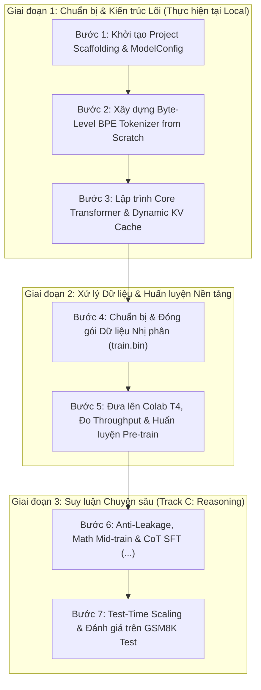

# Lộ Trình Phát Triển Mô Hình LLM From Scratch (Google Colab T4 / Single GPU)

Tài liệu này tổng hợp lộ trình kỹ thuật từng bước để xây dựng hoàn chỉnh mô hình ngôn ngữ lớn (Reasoning LLM) tự lập trình từ đầu, tối ưu hóa cho phần cứng **Google Colab GPU T4 (16GB VRAM)** và **RTX 3060/4090**.

---

## 🧭 Sơ Đồ Tổng Quan Quy Trình Triển Khai



---

## 📋 Chi Tiết Từng Bước Triển Khai

### 🔹 Bước 1: Khởi tạo Khung Dự Án & Cấu Hình Model
* **Mục tiêu**: Chuẩn hóa môi trường, cấu hình siêu tham số và tính toán chính xác số lượng tham số trước khi viết code mô hình.
* **Các việc cần làm**:
  - [x] Tạo file `pyproject.toml` định nghĩa dependencies (`torch>=2.2.0`, `numpy`, `pyyaml`, `datasets`, `tqdm`, `pytest`).
  - [x] Tạo thư mục `configs/` chứa 2 cấu hình phần cứng:
    - `configs/compact_12gb.yaml`: Cấu hình **~43.8M tham số** ($43,790,848$ params) cho Colab T4 / RTX 3060 (`d_model=512`, `12 layers`, `8 heads / 4 kv_heads`, `vocab=16,384`).
    - `configs/standard_24gb.yaml`: Cấu hình **~197.2M tham số** ($197,166,080$ params) cho Colab L4 / RTX 4090.
  - [x] Xây dựng class `ModelConfig` trong `src/model/config.py` hỗ trợ nạp YAML, tính toán `kv_cache_bytes` và đếm tổng tham số chính xác theo công thức tầng.
  - [x] Viết test `tests/test_config.py` và chạy `pytest` để xác thực tính đúng đắn của config. (✅ Đã pass 2/2 tests)

---

### 🔹 Bước 2: Tự Xây Dựng Tokenizer (Byte-Level BPE from Scratch)
* **Mục tiêu**: Tự xây dựng bộ mã hóa ký tự Byte-Level BPE tối ưu cho toán học, không dùng thư viện đóng gói sẵn (`tiktoken`, `tokenizers`).
* **Các việc cần làm**:
  - [x] Viết `src/tokenizer/pretokenizer.py`: Dùng Regex tách riêng từng chữ số đơn lẻ `0–9` (tránh ghép số tùy tiện, ví dụ `1234` luôn thành `['1','2','3','4']`), giữ nguyên khoảng trắng và xuống dòng.
  - [x] Viết `src/tokenizer/bpe.py`:
    - Khởi tạo từ 256 bytes UTF-8 cơ bản.
    - Học bảng ghép nối (merges) qua tần suất xuất hiện trên corpus mẫu.
    - Cố định **7 Special Tokens**:
      - `0: <|pad|>`
      - `1: <|bos|>`
      - `2: <|eos|>`
      - `3: <|user|>`
      - `4: <|assistant|>`
      - `5: <think>`
      - `6: </think>`
    - Kích thước từ vựng mục tiêu: `vocab_size = 16,384`.
    - Hỗ trợ lưu và nạp từ `vocab.json` và `merges.txt`.
  - [x] Viết test kiểm tra encode/decode lossless (chuỗi nguyên bản sau khi decode phải trùng khớp 100%). (✅ Đã pass 2/2 tests)

---

### 🔹 Bước 3: Lập Trình Kiến Trúc Lõi Transformer & Dynamic KV Cache (Tại Local)
* **Mục tiêu**: Xây dựng kiến trúc Transformer hiện đại dạng Pre-Norm Decoder-Only và chứng minh tính đúng đắn số học qua Unit Test tại máy cục bộ trước khi train.
* **Các việc cần làm**:
  - [x] Tự lập trình các module PyTorch thuần:
    - `RMSNorm` (Pre-norm không bias, ổn định gradient).
    - `RoPE` (Rotary Position Embedding, $\theta = 10,000$).
    - `Attention`: Grouped-Query Attention (GQA) với phép tính thủ công $Q @ K^T / \sqrt{d_{\text{head}}}$ kèm causal mask, hỗ trợ cờ đối chứng `attn_backend="sdpa"`.
    - `SwiGLU`: Feed-Forward Network với kích thước $d_{\text{ff}} \approx \frac{8}{3} d_{\text{model}}$ (bội số 128).
    - `DynamicKVCache`: Bộ đệm tensor chunked dynamic, hỗ trợ phương thức sao chép độc lập `copy_batch` cho Test-Time Scaling.
    - `DecoderOnlyLM`: Ghép toàn bộ transformer blocks và kích hoạt **Weight Tying** (`embed_tokens.weight == lm_head.weight`).
  - [x] **Bộ Unit Test kiểm thử sống còn (TDD)**:
    - **Cấp 1 — Numerical Equivalence**: Sai số logits giữa *Bật KV Cache* và *Tắt KV Cache* ở FP32 phải đạt $\max |\Delta| < 10^{-5}$ (✅ Đã verify: $\max < 10^{-5}$, mean $< 10^{-6}$).
    - **Cấp 2 — Functional Equivalence**: Sinh Greedy tokens từ cùng một prompt phải trùng khớp 100% giữa hai chế độ (✅ Đã verify: 100% exact match).

---

### 🔹 Bước 4: Đóng Gói Dữ Liệu thành File Nhị Phân (`train.bin`)
* **Mục tiêu**: Chuyển đổi dữ liệu text thành mảng nhị phân phẳng (`uint16`) để nạp trực tiếp qua `numpy.memmap`, tránh tắc nghẽn I/O trên Google Colab.
* **Các việc cần làm**:
  - [x] Lấy khoảng **250.000 – 300.000 mẫu** (~200M – 300M tokens) từ nguồn chất lượng cao (FineWeb-2 subset tiếng Việt hoặc TinyStories/FineWeb-Edu).
  - [x] Dùng bộ Tokenizer đã xây dựng ở Bước 2 để tokenize toàn bộ văn bản.
  - [x] Nối chuỗi kèm token `<|bos|>` và `<|eos|>`, ghi trực tiếp vào file nhị phân `train.bin` kiểu dữ liệu `uint16` (`src/data/pretrain_dataset.py`, `scripts/pack_data.py`).
  - [x] Dung lượng file nhị phân chỉ khoảng **~400 MB – 600 MB**, nén và tải lên Google Drive nhanh chóng (✅ Đã verify: memory-mapped dataset & alignment test pass).

---

### 🔹 Bước 5: Đưa Lên Google Colab T4, Đo Throughput & Huấn Luyện Pre-training
* **Mục tiêu**: Thực hiện pre-training mô hình Base đạt độ hội tụ ngữ pháp và câu từ mạch lạc trên Colab GPU T4.
* **Các việc cần làm**:
  - [x] Mở Colab T4 (16GB VRAM), clone mã nguồn và liên kết với Google Drive (`drive.mount('/content/drive')`).
  - [x] Chạy script `scripts/benchmark_throughput.py`: Đo tốc độ sinh tokens/giây thực tế của T4 (dự kiến ~8,000 – 12,000 tokens/s với FP16 AMP) để chốt số bước huấn luyện (`training steps`).
  - [x] Khởi chạy huấn luyện pre-training (`scripts/train_core.py`):
    - Dùng **FP16 Mixed Precision** (`torch.cuda.amp.autocast`).
    - Optimizer: **AdamW** ($\beta_1=0.9, \beta_2=0.95$, weight decay 0.1), Cosine Annealing Learning Rate (Peak LR: `6e-4`).
    - Tự động lưu checkpoint định kỳ (mỗi 500 – 1,000 steps) vào Google Drive để tránh mất phiên khi Colab ngắt kết nối.
  - [x] Cung cấp notebook [notebooks/colab_pretrain_t4.ipynb](notebooks/colab_pretrain_t4.ipynb) chuẩn bị sẵn cho quy trình huấn luyện và test generation (✅ Đã verify: 22/22 unit tests pass).

---

### 🔹 Bước 6: Chuyển Tiếp Sang Track C (Reasoning & CoT SFT)
* **Mục tiêu**: Rèn luyện năng lực tư duy từng bước cho mô hình trên bài toán lập luận số học (GSM8K).
* **Các việc cần làm**:
  - [ ] **Lọc rò rỉ dữ liệu (Anti-Leakage Filter 3 tầng)**: So khớp Exact + Normalized + Near-Duplicate (5-gram Jaccard $\ge 0.80$) giữa tập train với 1,319 câu GSM8K Test.
  - [ ] **CoT SFT Training**: Huấn luyện với cấu trúc phân tách rõ ràng:
    ```text
    <|bos|><|user|>
    {question}
    <|assistant|>
    <think>
    {reasoning_steps}
    </think>
    #### {final_answer}<|eos|>
    ```
    Áp dụng **Assistant-Only Loss Masking** (chỉ tính gradient loss cho phần câu trả lời của trợ lý).
  - [ ] **Test-Time Scaling**: Triển khai Majority Voting (`Maj@K`) và Best-of-N Re-ranking trên shared pool $K=16$ rollouts.
  - [ ] Đánh giá toàn diện trên 1,319 câu GSM8K Test, vẽ biểu đồ Compute-Accuracy Frontier và phân tích lỗi.

---

## 📌 Bảng Tham Chiếu Tài Liệu Kỹ Thuật

| Tài liệu | Đường dẫn | Mục đích |
|---|---|---|
| **Đặc tả Hệ thống** | [spec.md](specs/001-llm-reasoning-system/spec.md) | Kiến trúc tổng thể, công thức toán và quy chuẩn kỹ thuật |
| **Kế hoạch Triển khai 1** | [core-llm-kv-cache.md](docs/superpowers/plans/2026-11-10-core-llm-kv-cache.md) | Chi tiết code từng file cho Tokenizer, Transformer & KV Cache |
| **Kế hoạch Triển khai 2** | [track-c-reasoning-scaling.md](docs/superpowers/plans/2026-11-10-track-c-reasoning-scaling.md) | Chi tiết pipeline huấn luyện CoT SFT và Test-Time Compute |
