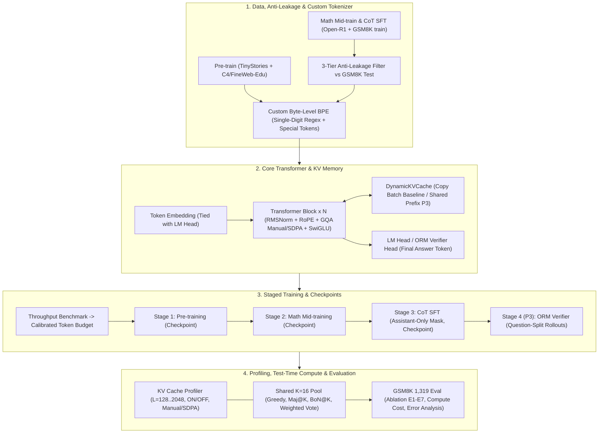
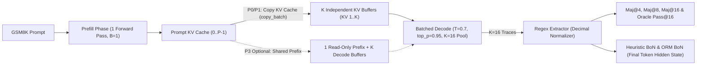

# System Proposal & Specification: Self-Built Reasoning LLM (Core Foundation + Track C: Reasoning & Test-Time Compute)

**Feature ID**: `001-llm-reasoning-system`  
**Status**: Revised Specification (Post Technical Review)  
**Scope**: Mandatory Core LLM Stack + Track C (Reasoning & Test-Time Compute)  
**Target Hardware**: Dual-Profile — **Compact** (RTX 3060 12GB / Colab T4 16GB) & **Standard** (RTX 4090 24GB / Colab L4 24GB)  
**Project Timeline**: 4 Weeks (Prioritized P0 → P1 → P2 → P3)

---

## 1. Tổng quan & Định hướng Hệ thống

### 1.1. Mục tiêu
Xây dựng hoàn chỉnh một hệ thống Mô hình Ngôn ngữ Lớn (LLM) tự lập trình từ đầu (*from scratch*) trên đơn GPU trong khung thời gian 4 tuần, gồm hai tầng:

1. **Tầng Nền tảng Bắt buộc (Core Foundation)**:
   - Tự lập trình mô hình **Byte-Level BPE Tokenizer** tối ưu cho ký tự số học và các thẻ suy luận đặc biệt.
   - Tự lập trình kiến trúc **Modern Decoder-Only Transformer** (`RMSNorm`, `RoPE`, `GQA`, `SwiGLU`, Manual PyTorch Attention + nhánh đối chứng `SDPA`).
   - Tự thiết kế cấu trúc dữ liệu **Dynamic KV Cache** dạng tensor phục vụ sinh từ tự hồi quy, kèm bộ **Profiling thực nghiệm** đối chiếu Bật vs. Tắt KV Cache tại các độ dài ngữ cảnh $L \in \{128, 512, 1024, 2048\}$.
2. **Tầng Chuyên sâu — Hướng C (Reasoning & Test-Time Compute)**:
   - Huấn luyện **Chain-of-Thought (CoT) SFT** với định dạng tách biệt rõ quá trình tư duy `<think>...</think>` và đáp án cuối cùng `#### <answer>`.
   - Xây dựng động cơ **Test-Time Scaling** với **Majority Voting (Self-Consistency)** và **Best-of-N Re-ranking** (Heuristic Scorer tự viết và Learned ORM Verifier tùy chọn theo độ ưu tiên P3).
   - Thực hiện **Ablation Study (E1–E7)**, đánh giá cân bằng theo **ngân sách tính toán (Compute-Budget-Matched)**, phân tích độ dài suy luận vs. độ chính xác (tránh ngộ nhận nhân quả), và **Error Analysis** trên **1.319 câu GSM8K Test Split**.

### 1.2. Phạm vi "From Scratch" & Thư viện Được phép
Để đảm bảo tính minh bạch tuyệt đối khi nghiệm thu đồ án, ranh giới tự lập trình được quy định rõ như sau:

| Thành phần | Quy định triển khai | Ghi chú kỹ thuật |
|---|---|---|
| **Tokenizer (Byte-Level BPE)** | **Tự lập trình 100%** | Thuật toán train/merge/encode/decode thuần Python + `re`; không dùng `tiktoken` hay HF `tokenizers`. |
| **RMSNorm, RoPE, SwiGLU** | **Tự lập trình 100%** | Xây dựng bằng `torch.nn.Module` và phép toán tensor PyTorch cơ bản. |
| **GQA & Causal Attention** | **Tự lập trình 100% (mặc định)** | Tự cài đặt `Q, K, V` projections, `RoPE`, lặp KV heads, phép nhân `Q @ K^T / sqrt(d_head)`, causal mask `-inf`, `softmax`, `@ V`. Có thêm cờ `attn_backend="sdpa"` tách biệt riêng để benchmark tối ưu. |
| **Transformer Block & LM** | **Tự lập trình 100%** | Không sử dụng `AutoModelForCausalLM`, `LlamaForCausalLM` hay kiến trúc đóng gói sẵn. |
| **Dynamic KV Cache** | **Tự thiết kế & lập trình 100%** | Bộ đệm tensor động, cập nhật theo bước và cơ chế Copy/Shared Prefix. |
| **Generation & Test-Time Scaling** | **Tự lập trình 100%** | Prefill, Decode loop, Temperature/Top-p, Majority Voting, Heuristic Scorer, Best-of-N. |
| **Training & ORM Pipeline** | **Tự lập trình 100%** | Data packing, Assistant-only loss masking, AdamW/Cosine loop, Rollout & `BCEWithLogitsLoss` cho ORM. |
| **Hạ tầng phụ trợ được phép** | **Thư viện chuẩn** | PyTorch (`torch` tensor ops, autograd, `torch.amp`), HF `datasets` (chỉ để tải dữ liệu thô GSM8K, TinyStories, C4/FineWeb-Edu, Open-R1), NumPy, Pandas, Matplotlib, TensorBoard/W&B. |

---

## 2. Lựa chọn Kỹ thuật Chi tiết

### 2.1. Khối Kiến trúc Lõi — Modern Decoder-Only Transformer
Áp dụng kiến trúc chuẩn **Pre-Norm Decoder-Only** (họ Llama-3 / Qwen-2.5):

| Thành phần | Kỹ thuật lựa chọn | Lý do chọn & Lợi ích thiết kế |
|---|---|---|
| **Normalization** | **RMSNorm** (Pre-Norm, không bias) | Loại bỏ tính trung bình so với LayerNorm, giảm chi phí bộ nhớ và ổn định gradient ở 12–16 lớp. |
| **Positional Encoding** | **RoPE** (Rotary Position Embedding, $\theta = 10{,}000$) | Mã hóa vị trí tương đối trực tiếp trên $Q, K$; tương thích tự nhiên với `start_pos` của KV Cache. |
| **Attention** | **Grouped-Query Attention (GQA)** (`bias=False`) + `attn_backend` (`manual` mặc định / `sdpa` đối chứng) | Giảm 50% (Compact) đến 75% (Standard) kích thước KV Cache so với MHA; tách bạch hoàn toàn bản tự tính `Q@K^T` với bản tối ưu `SDPA`. |
| **Feed-Forward** | **SwiGLU** ($d_{\text{ff}} \approx \frac{8}{3} d_{\text{model}}$, bội số 128) | Biểu diễn phi tuyến tốt hơn GELU/ReLU với cùng số lượng tham số nhờ cổng SiLU. |
| **Embedding & Head** | **Weight Tying** (`embed_tokens.weight == lm_head.weight`) | Tiết kiệm ~8.4M tham số (Compact) và ~16.8M tham số (Standard), giảm nguy cơ overfitting. |
| **Precision** | `FP32` (kiểm chuẩn), `FP16 AMP` (T4/RTX 3060), `BF16` (L4/RTX 4090) | Kiểm tra correctness số học ở FP32 trước khi huấn luyện/đo tải bằng mixed precision. |

### 2.2. Hệ thống Quản lý Bộ nhớ, Dynamic KV Cache & Prefix Reuse
- **Cấu trúc `DynamicKVCache` (Chunked Dynamic Buffer)**:
  - Lưu cặp tensor `(k_cache, v_cache)` cho mỗi lớp có shape `(batch_size, n_kv_heads, capacity, d_head)` cùng con trỏ `seq_len`.
  - Khởi tạo sức chứa ban đầu `init_cap = 128`, tự động tăng theo bội số `chunk_size = 128` tới `block_size = 2048` khi `seq_len > capacity`. Cách này giữ tính động của bộ nhớ (không cấp phát full 2048 cho chuỗi ngắn 128) và tránh sao chép $O(L^2)$ của `torch.cat` mỗi bước.
- **Phân biệt 2 cơ chế tái sử dụng Prompt cho Test-Time Scaling**:
  1. **Cơ chế 1 — Copy KV Cache (`copy_batch`, ưu tiên triển khai P0/P1)**:
     - Luồng: `Prompt → Prefill (B=1) → Copy KV Cache (repeat_interleave) thành K bản sao độc lập (KV Cache 1..K)`.
     - *Ưu điểm*: Tránh tính lại prefill prompt $K$ lần; từng nhánh decode có vùng nhớ riêng biệt nên cập nhật cực kỳ đơn giản và an toàn correctness.
     - *Nhược điểm*: Tốn thêm $K \times$ dung lượng VRAM cho phần prompt đã prefill.
  2. **Cơ chế 2 — Shared Prefix KV Cache (`SharedPrefixKVCache`, cải tiến P3 tùy chọn)**:
     - Luồng: `Prompt → Prefill (B=1) → Giữ 1 bản Shared Prefix KV Cache (read-only) + Cấp phát K buffer riêng cho phần token sinh mới`.
     - *Ưu điểm*: Tiết kiệm tối đa VRAM cho phần prompt khi $K$ lớn ($K=16$).
     - *Nhược điểm*: Phải tính attention hai vùng (shared prefix + private suffix) hoặc quản lý chỉ số ghép view phức tạp hơn.
  - *Lưu ý kỹ thuật*: Không nhầm lẫn `repeat_interleave` (tạo bản sao vật lý) với `expand()` (tạo view chia sẻ bộ nhớ dễ gây lỗi ghi đè khi cập nhật token mới).
- **Kiểm chứng Tương đương KV Cache (2 Cấp độ)**:
  - **Cấp 1 — Numerical Equivalence**: Kiểm tra trước trên **FP32** với ngưỡng chặt $\max |\text{Logits}_{\text{cache}} - \text{Logits}_{\text{no\_cache}}| < 10^{-5}$ (kèm báo cáo sai số trung bình `mean_abs_err`). Với **FP16/BF16**, đo và ghi nhận `max_abs_err` & `mean_abs_err` thực tế (tham chiếu $\le 10^{-2}$ tùy kernel attention) thay vì ép cứng một ngưỡng quá hẹp dễ gây false-fail.
  - **Cấp 2 — Functional Equivalence**: Chạy sinh Greedy 64 token từ cùng prompt trong chế độ tất định → yêu cầu **100% chuỗi token trùng khớp** ở FP32 (và ghi nhận tỷ lệ khớp ở FP16/BF16).
- **Kịch bản Profiling Thực nghiệm ($L \in \{128, 512, 1024, 2048\}$)**:
  - Đối chiếu `kv_cache=True` vs. `kv_cache=False` (kèm so sánh `attn_backend="manual"` vs `"sdpa"`), dùng `torch.cuda.synchronize()`, warmup + lặp nhiều lượt.
  - Chỉ số: **TTFT (ms)**, **TPOT Mean/P95 (ms/token)**, **Throughput (tokens/s)**, **Peak & Allocated VRAM (MB)** đối chiếu công thức lý thuyết:
    $$\text{VRAM}_{\text{KV}} = 2 \times n_{\text{layers}} \times B \times n_{\text{kv\_heads}} \times L \times d_{\text{head}} \times 2\text{ bytes}$$

### 2.3. Tự xây dựng Tokenizer (Math-Aware Byte-Level BPE)
- Thuật toán Byte-Level BPE từ đầu (256 byte UTF-8 gốc + bảng merge học trên corpus mẫu, lưu `vocab.json` & `merges.txt`).
- **Single-Digit Pre-tokenization Regex**: Tách riêng từng chữ số đơn lẻ `0–9` để tránh ghép số tùy tiện (`1234` luôn thành `['1','2','3','4']`), bảo toàn xuống dòng/khoảng trắng.
- **Kích thước từ vựng**: `vocab_size = 16,384` (7 special tokens + 256 bytes + 16,121 merges).
- **7 Special Tokens cố định**: `0: <|pad|>`, `1: <|bos|>`, `2: <|eos|>`, `3: <|user|>`, `4: <|assistant|>`, `5: <think>`, `6: </think>`.

### 2.4. Dữ liệu, Anti-Leakage & Huấn luyện CoT SFT
- **Bảng phân vai Dataset rõ ràng**:

| Dataset | Giai đoạn | Mục đích |
|---|---|---|
| **TinyStories** | Stage 1 — Pre-training | Học cú pháp tiếng Anh cơ bản và tính mạch lạc ngôn ngữ |
| **C4 / FineWeb-Edu (subset)** | Stage 1 — Pre-training | Bổ sung tri thức phổ thông và cấu trúc văn bản đa dạng |
| **Open-R1 (math subset)** | Stage 2 — Math Mid-training | Làm quen lập luận toán học, ký hiệu và biểu thức nhiều bước |
| **GSM8K `train` (7.473 câu)** | Stage 3 — CoT SFT | Học giải toán theo từng bước với cấu trúc `<think>...</think>` + `####` |
| **GSM8K `test` (1.319 câu)** | Evaluation | Đánh giá độc lập năng lực suy luận toán học |

- **Kiểm soát Rò rỉ Dữ liệu (Anti-Leakage 3 tầng)**:
  Trước khi đưa `Open-R1 subset` và `GSM8K train` vào huấn luyện, lọc bỏ mọi mẫu có nguy cơ trùng lặp với **1.319 câu GSM8K Test** qua 3 bộ lọc:
  1. *Exact Duplicate Detection*: Trùng khớp chuỗi câu hỏi nguyên bản.
  2. *Normalized Question Matching*: Chuẩn hóa chữ thường, bỏ dấu câu/khoảng trắng thừa, chuẩn hóa định dạng số rồi so khớp.
  3. *Near-Duplicate Detection*: Tính độ tương đồng n-gram (5-gram Jaccard $\ge 0.80$) để loại các bài toán trùng lặp diễn đạt lại.
- **Chính sách Ngân sách Token Pre-training (Khả thi 4 tuần)**:
  > *The pre-training token budget will be determined based on empirical GPU throughput measurements and the available training time. The primary objective is to obtain a functional and reproducible pretrained checkpoint rather than enforce a fixed token budget.*
  - Phân biệt rạch ròi 3 khái niệm: **Token Budget** (tổng token học), **Training Throughput** (tokens/giây đo thực nghiệm qua benchmark 200 steps), và **Training Steps** (số bước cập nhật). Luôn lưu checkpoint sau mỗi pha (`Pre-train` → `Mid-train` → `CoT SFT`) để tái sử dụng không cần train lại từ đầu.
- **Định dạng CoT SFT & Loss Masking**:
  ```text
  <|bos|><|user|>
  {question}
  <|assistant|>
  <think>
  {reasoning_steps}
  </think>
  #### {final_answer}<|eos|>
  ```
  - Làm sạch thẻ `<<expr=val>>` trong GSM8K thành phép tính tự nhiên trong `<think>`; dùng **Assistant-Only Loss Masking** (`ignore_index = -100` cho phần prompt `<|user|>...<|assistant|>`).

### 2.5. Test-Time Compute, Định nghĩa Chỉ số & ORM Verifier
- **Phân biệt rõ 4 Chỉ số Đánh giá**:

| Chỉ số | Cách lựa chọn đáp án | Bản chất thực nghiệm |
|---|---|---|
| **Pass@1** | Sinh 1 chuỗi duy nhất (`Greedy T=0`), lấy kết quả đó | Baseline thực tế chi phí thấp nhất ($1\times$ compute) |
| **Pass@K** | Đúng nếu **ít nhất 1 trong $K$** chuỗi sinh ra đúng | **Oracle Upper Bound** — giả định biết trước đáp án đúng, *không phải chiến lược suy luận thực tế* |
| **Maj@K** | Chọn đáp án số xuất hiện nhiều nhất trong $K$ chuỗi | Chiến lược **Majority Voting** thực tế không cần Verifier |
| **BoN@K** | Scorer / Verifier chấm điểm và chọn 1 chuỗi tốt nhất trong $K$ chuỗi | Chiến lược **Best-of-N** thực tế |

> *Pass@K is reported as an oracle upper-bound metric, whereas Majority Voting and Best-of-N measure practical inference-time selection strategies.*

- **Giao thức Pool Dùng chung $K=16$ (Fair Evaluation)**:
  - Với mỗi câu hỏi trong 1.319 câu GSM8K Test, sinh **1 tập dùng chung $K=16$ rollouts** ($T=0.7, \text{top\_p}=0.95$) bằng `Copy KV Cache` (hoặc micro-batch $2 \times 8$ nếu giới hạn VRAM), sau đó tính công bằng trên cùng pool đó: `Maj@4` (4 mẫu đầu), `Maj@8` (8 mẫu đầu), `Maj@16`, `BoN@8`, `BoN@16`, và `Pass@16`. Chạy riêng `Greedy (T=0, K=1)` cho `Pass@1`.
- **2 Cấp Scorer / Verifier cho Best-of-N**:
  - **Cấp 1 — Heuristic & Arithmetic Consistency Scorer (P2, tự viết)**: Tổng hợp điểm tuân thủ định dạng (`<think>...</think>` + `#### số`), mean log-probability chuẩn hóa độ dài, và tỷ lệ phép tính sơ cấp hợp lệ trong `<think>` (parser an toàn không dùng `eval`).
  - **Cấp 2 — Learned Outcome Reward Model / ORM Verifier (P3)**:
    > *The ORM predicts the probability of a generated reasoning trace being correct using the final answer representation. It is trained on correctness-labeled rollouts generated from the CoT-SFT checkpoint, using `BCEWithLogitsLoss`.*
    - **Dữ liệu huấn luyện ORM**: Chia `GSM8K train` thành tập `ORM-train` / `ORM-val` **theo cấp độ câu hỏi** (tuyệt đối không để các rollout của cùng 1 câu hỏi nằm ở cả hai tập) → sinh $K=8$ reasoning traces bằng checkpoint CoT-SFT → so sánh đáp án trích xuất với ground truth để gán nhãn `1` (đúng) / `0` (sai) → train head `Linear(d_model, 1)` trên hidden state cuối cùng.
    - **Vị trí lấy Hidden State**: Thống nhất lấy hidden state tại **token kết thúc của câu trả lời cuối cùng** (token cuối trước `<|eos|>`, sau `#### <answer>`), đảm bảo ORM quan sát được cả chuỗi `<think>` lẫn đáp án xuất ra (thay vì dừng tại `</think>`).

### 2.6. Kế hoạch Thực nghiệm: Ablation, Compute-Budget, CoT Length & Error Analysis
- **Bảng Ablation Study (E1–E7)**:

| Thí nghiệm | Cấu hình | Mục tiêu trả lời |
|---|---|---|
| **E1** | Greedy, $K=1$ | Baseline `Pass@1` ở chi phí $1\times$ |
| **E2** | Majority Voting, $K=4$ | Tác động khi bắt đầu mở rộng số mẫu |
| **E3** | Majority Voting, $K=8$ | Mức tăng hiệu năng theo quy mô sampling |
| **E4** | Majority Voting, $K=16$ | Khả năng mở rộng và điểm bão hòa của voting |
| **E5** | Best-of-N + Heuristic Scorer ($K=8, 16$) | Hiệu quả của hàm chấm điểm tự viết dựa trên luật/log-prob |
| **E6** | Best-of-N + Learned ORM ($K=8, 16$) *(P3)* | So sánh trực tiếp **E5 vs. E6**: ORM học được có thực sự chọn chuỗi tốt hơn Heuristic Scorer không? |
| **E7** | Verifier-Weighted Majority Voting *(P3)* | Hiệu quả kết hợp trọng số Verifier với bỏ phiếu đa số |

- **Đánh giá theo Ngân sách Tính toán (Compute-Budget-Matched Evaluation)**:
  - Báo cáo song song 2 góc nhìn cho E1–E7: (1) **Chất lượng** (`Pass@1`, `Maj@K`, `BoN@K`, `Pass@16`), và (2) **Chi phí thực tế** (tổng số generated tokens, inference latency, peak VRAM, số lượt forward).
  - Vẽ biểu đồ **Compute–Accuracy Frontier** (Trục X: Tổng số token sinh ra; Trục Y: Accuracy) để kiểm chứng hiệu quả sử dụng Test-Time Compute một cách công bằng.
- **Phân tích Độ dài CoT & Độ chính xác (Tránh ngộ nhận nhân quả)**:
  - Tính Spearman / Point-Biserial correlation và chia bucket độ dài (`<64`, `64–128`, `128–256`, `256–512`, `>512`), nhưng **bắt buộc ghi nhận đầy đủ 4 chỉ số trong từng bucket**: (1) tỷ lệ reasoning hợp lệ (`format_valid`), (2) accuracy, (3) tỷ lệ repetition loop, và (4) độ dài trung bình/trung vị riêng cho nhóm trả lời **Đúng** vs. **Sai**.
  - Khẳng định rõ kết quả chỉ thể hiện **tương quan thống kê**, *không chứng minh quan hệ nhân quả* rằng ép chuỗi `<think>` dài hơn sẽ giúp mô hình thông minh hơn.
- **Phân tích Lỗi (Error Analysis — 6 nhóm lỗi dự kiến & $\ge 5$ ca định tính)**:
  - Kiểm tra và phân loại định tính **tối thiểu 5 trường hợp trả lời sai thực tế** trên GSM8K Test theo 6 nhóm lỗi dự kiến (*expected error categories*):
    1. *Tokenization Error* (tách/giải mã sai biểu thức số học)
    2. *Arithmetic Error* (tính nhẩm sai dù hướng giải đúng)
    3. *Logical Error* (lập luận sai hướng)
    4. *Reasoning Loop* (lặp vô hạn trong `<think>`, tràn ngữ cảnh)
    5. *Answer Extraction Error* (giải đúng nhưng regex trích xuất sai)
    6. *Verifier Error* (ORM/Scorer chọn chuỗi sai thay vì chuỗi đúng có sẵn trong pool)

---

## 3. Sơ đồ Kiến trúc Module Dự kiến

### 3.1. Kiến trúc Tổng thể 4 Tầng



### 3.2. Luồng Thực thi Copy KV Cache (P0/P1) vs. Shared Prefix KV Cache (P3)



### 3.3. Cấu trúc Module Codebase Dự kiến

```text
LLM-self-built/
├── configs/
│   ├── compact_12gb.yaml          # 43.8M (RTX 3060 12GB / Colab T4)
│   └── standard_24gb.yaml         # 197.2M (RTX 4090 24GB / Colab L4)
├── src/
│   ├── tokenizer/
│   │   ├── bpe.py                 # Byte-Level BPE train/encode/decode from scratch
│   │   └── pretokenizer.py        # Regex tách chữ số đơn lẻ 0-9
│   ├── model/
│   │   ├── config.py              # ModelConfig (kèm attn_backend: manual | sdpa)
│   │   ├── norm.py                # RMSNorm
│   │   ├── rope.py                # RoPE precompute & apply
│   │   ├── attention.py           # GQA tự tính thủ công (Q@K^T) + nhánh đối chứng SDPA
│   │   ├── ffn.py                 # SwiGLU FFN
│   │   └── transformer.py         # DecoderOnlyLM
│   ├── cache/
│   │   └── dynamic_kv_cache.py    # DynamicKVCache (chunked buffer, copy_batch, reset)
│   ├── data/
│   │   ├── leakage_filter.py      # Exact + Normalized + Near-Duplicate check vs GSM8K test
│   │   ├── pretrain_dataset.py    # Packed uint16 memmap shards
│   │   ├── cot_dataset.py         # <think>...</think> + Assistant-Only Loss Masking
│   │   └── rollout_dataset.py     # Question-level split rollouts cho ORM
│   ├── training/
│   │   ├── trainer.py             # AdamW, Cosine LR, Throughput benchmark, Checkpointing
│   │   └── verifier_trainer.py    # ORM Verifier training (BCEWithLogitsLoss)
│   ├── inference/
│   │   ├── generator.py           # Prefill + Decode (KV Cache ON/OFF, copy_batch)
│   │   ├── scaling.py             # Greedy, Maj@K, BoN@K, Weighted Vote từ pool K=16
│   │   └── scorer.py              # Heuristic Scorer + OutcomeVerifierModel (ORM)
│   └── eval/
│       ├── kv_profiler.py         # Benchmark TTFT, TPOT, Tokens/s, VRAM (L=128..2048)
│       ├── gsm8k_eval.py          # Regex extraction, Pass@1, Maj@K, BoN@K, Pass@16
│       └── reasoning_analysis.py  # Length buckets, loop rate, compute curve, error cases
├── scripts/
│   ├── train_tokenizer.py
│   ├── run_kv_profiling.py
│   ├── benchmark_throughput.py    # Đo tokens/s trước khi chốt pre-training budget
│   ├── train_core.py
│   ├── train_cot_sft.py
│   ├── train_verifier.py
│   └── eval_gsm8k.py
└── tests/
```

---

## 4. Siêu tham số Định hướng & Dự toán Tài nguyên

### 4.1. So sánh 2 Cấu hình Mô hình Lõi

| Siêu tham số | Cấu hình A: **Compact** (RTX 3060 12GB / Colab T4 16GB) | Cấu hình B: **Standard** (RTX 4090 24GB / Colab L4 24GB) | Ghi chú kỹ thuật |
|---|---|---|---|
| `vocab_size` | `16,384` | `16,384` | Byte-Level BPE chung (7 special tokens) |
| `block_size` (`max_seq_len`) | `2,048` | `2,048` | Bao phủ đủ mốc profiling $L=2048$ & chuỗi CoT |
| `d_model` | `512` | `1,024` | Tối ưu Tensor Core |
| `n_layers` | `12` | `16` | Độ sâu 12–16 tầng |
| `n_heads` / `n_kv_heads` | `8` / `4` (GQA 2:1) | `16` / `4` (GQA 4:1) | `d_head = 64` đồng nhất ở cả 2 cấu hình |
| `d_ff` (SwiGLU) | `1,408` ($2.75\times$) | `2,816` ($2.75\times$) | $\approx \frac{8}{3} d_{\text{model}}$, bội số 128 |
| `rope_theta` | `10,000.0` | `10,000.0` | Chuẩn cho `block_size = 2048` |
| `tie_word_embeddings` | `True` | `True` | Chia sẻ Embedding & LM Head |
| **Tổng số tham số (chính xác)** | **43,790,848 (~43.8M)** | **197,166,080 (~197.2M)** | Đã kiểm chứng theo cấu trúc layer |
| **VRAM Copy KV Cache (`B=1`, `L=2048`)** | **24.0 MiB** (`FP16`) | **32.0 MiB** (`BF16`) | $2 \times n_{\text{layers}} \times n_{\text{kv}} \times 2048 \times 64 \times 2\text{B}$ |
| **VRAM Copy KV Cache (`B=16`, `L=2048`)** | **384.0 MiB** (`FP16`) | **512.0 MiB** (`BF16`) | Trường hợp sinh cả pool $K=16$ (hoặc micro-batch $2 \times 8$) |
| **VRAM Huấn luyện dự kiến** | **~5.5 – 8.5 GB** | **~12 – 17 GB** | Mixed precision + Gradient Checkpointing |

### 4.2. Siêu tham số theo Pha Huấn luyện & Suy luận

| Pha | Tham số định hướng | Cấu hình Compact (12–16GB) | Cấu hình Standard (24GB) |
|---|---|---|---|
| **Pre-training** | Precision / Optimizer | `FP16 AMP` / `AdamW (0.9, 0.95, wd=0.1)` | `BF16` / `AdamW (0.9, 0.95, wd=0.1)` |
| | Effective Batch / LR | `~65K–131K tokens/step`, Peak LR `6e-4` (Cosine) | `~131K–262K tokens/step`, Peak LR `3e-4` (Cosine) |
| | Token Budget | **Xác định động sau `benchmark_throughput.py`** (mục tiêu: checkpoint ổn định, tái lập được trong quỹ GPU khả dụng) | **Xác định động sau `benchmark_throughput.py`** (mục tiêu: checkpoint ổn định, tái lập được trong quỹ GPU khả dụng) |
| **Math Mid-training** | LR / Context | `1e-4` → `2e-5`, `seq_len=2048`, đã lọc leakage | `8e-5` → `1e-5`, `seq_len=2048`, đã lọc leakage |
| **CoT SFT** | LR / Epochs / Mask | `2e-5`–`5e-5`, 3–5 epochs, Assistant-only mask | `1e-5`–`3e-5`, 3–4 epochs, Assistant-only mask |
| **ORM Verifier (P3)** | Loss / Rollouts / Pooling | `BCEWithLogitsLoss`, question-level split, $K=8$ rollouts/câu, final answer hidden state | `BCEWithLogitsLoss`, question-level split, $K=8$ rollouts/câu, final answer hidden state |
| **Test-Time Scaling** | Pool & Decoding | Shared pool $K=16$, $T=0.7$, $\text{top\_p}=0.95$, `max_new_tokens=768` | Shared pool $K=16$, $T=0.7$, $\text{top\_p}=0.95$, `max_new_tokens=768` |

---

## 5. Lộ trình 4 Tuần & Thứ tự Ưu tiên (P0 → P3)

Để quản trị rủi ro tiến độ trong 4 tuần và đảm bảo không để các mở rộng phức tạp (như ORM) ảnh hưởng tới phần bắt buộc:

| Tuần | Mục tiêu chính | Độ ưu tiên | Deliverables & Checkpoints |
|---|---|---|---|
| **Tuần 1** | **Core Foundation** | **P0** | Custom BPE Tokenizer, RMSNorm, RoPE, Manual GQA + SDPA flag, SwiGLU, `DecoderOnlyLM`, `DynamicKVCache` (`copy_batch`), 100% unit tests pass (Numerical FP32 + Functional equivalence). |
| **Tuần 2** | **Profiling & Base Pre-train** | **P0** | Autoregressive Generator, Benchmark KV Cache ON/OFF tại $L \in \{128..2048\}$, `benchmark_throughput.py`, Pre-trained checkpoint tái lập được trên GPU mục tiêu. |
| **Tuần 3** | **Reasoning Core & Scaling** | **P1 → P2** | **P1**: Anti-leakage filter, Math Mid-training checkpoint, CoT SFT checkpoint (`<think>...</think>`), Greedy `Pass@1` & Majority Voting (`Maj@4, 8, 16`) trên shared $K=16$ pool.<br>**P2**: Heuristic & Arithmetic Scorer (`BoN@8, 16`), Compute-budget tracking. |
| **Tuần 4** | **Eval, Ablation & Report** | **P1–P2 + P3** | **P1–P2**: Chấm toàn bộ 1.319 câu GSM8K Test, Ablation (E1–E5), phân tích độ dài `<think>` (4 chỉ số/bucket) & $\ge 5$ ca lỗi trong 6 nhóm, báo cáo IEEE + Demo/README.<br>**P3 (nếu còn thời gian)**: ORM Verifier (`E6`), Weighted Voting (`E7`), `SharedPrefixKVCache`. |

---

## 6. Yêu cầu Chức năng & Tiêu chí Nghiệm thu

### 6.1. Yêu cầu Chức năng (Functional Requirements)
- **FR-01 (Tokenizer)**: Byte-Level BPE từ đầu với regex tách chữ số đơn lẻ và 7 special tokens; round-trip UTF-8 chính xác 100%.
- **FR-02 (Modern Decoder Core)**: Cài đặt từ đầu RMSNorm, RoPE, Manual GQA (`Q@K^T`), SwiGLU; hỗ trợ thêm cờ `attn_backend="sdpa"` riêng để đối chứng tối ưu.
- **FR-03 (Dynamic KV Cache)**: `DynamicKVCache` cấp phát theo chunk, hỗ trợ `copy_batch` (P0/P1) và tương thích mở rộng `SharedPrefixKVCache` (P3).
- **FR-04 (2-Tier KV Equivalence & Profiling)**: Kiểm tra Numerical (FP32 $< 10^{-5}$; ghi nhận sai số thực nghiệm FP16/BF16) + Functional (100% khớp 64 token Greedy trên FP32); benchmark `TTFT`, `TPOT`, `Tokens/s`, `VRAM` tại $L \in \{128, 512, 1024, 2048\}$.
- **FR-05 (Anti-Leakage & Staged Training)**: Bộ lọc trùng lặp 3 tầng chống rò rỉ GSM8K test; benchmark throughput trước khi chốt ngân sách pre-train; CoT SFT với Assistant-only loss masking.
- **FR-06 (Shared-Pool Test-Time Scaling & Verifiers)**: Sinh pool $K=16$ dùng chung để tính `Maj@4/8/16`, `BoN@8/16` (Heuristic P2; ORM P3 dùng hidden state token đáp án cuối và question-level split), `Pass@16` (Oracle), song song `Greedy Pass@1`.
- **FR-07 (GSM8K Eval & Compute-Matched Analysis)**: Chấm tự động 1.319 câu GSM8K test bằng `Decimal`, xuất bảng Ablation E1–E7, biểu đồ Accuracy vs. Total Generated Tokens, phân tích độ dài `<think>` theo 4 chỉ số/bucket và phân tích $\ge 5$ lỗi định tính.

### 6.2. Tiêu chí Thành công (Success Criteria)
- **SC-01**: Toàn bộ module lõi (Tokenizer, Transformer Manual Attention, DynamicKVCache) vượt qua unit tests và kiểm chứng KV Cache 2 cấp độ (FP32 $\max|\Delta\text{logits}| < 10^{-5}$, 100% khớp 64 token Greedy).
- **SC-02**: Hoàn thành báo cáo & biểu đồ KV Cache Profiling ON vs. OFF đủ 4 mốc $L \in \{128, 512, 1024, 2048\}$ kèm đối chứng `manual` vs. `sdpa`.
- **SC-03**: Pipeline huấn luyện có checkpoint tái lập qua từng giai đoạn sau khi đã chạy throughput benchmark và lọc leakage 3 tầng.
- **SC-04**: Hoàn thành đánh giá **1.319 câu GSM8K Test Split** cho tất cả chiến lược P1–P2 (và P3 nếu triển khai), báo cáo đầy đủ cả **chất lượng** (`Pass@1`, `Maj@K`, `BoN@K`, `Pass@16` oracle) lẫn **chi phí tính toán** (tokens, latency, VRAM, forward count).
- **SC-05**: Hoàn thành phân tích độ dài `<think>` đúng phương pháp (không quy kết nhân quả) và phân tích tối thiểu 5 ca lỗi cụ thể theo 6 nhóm lỗi dự kiến.
